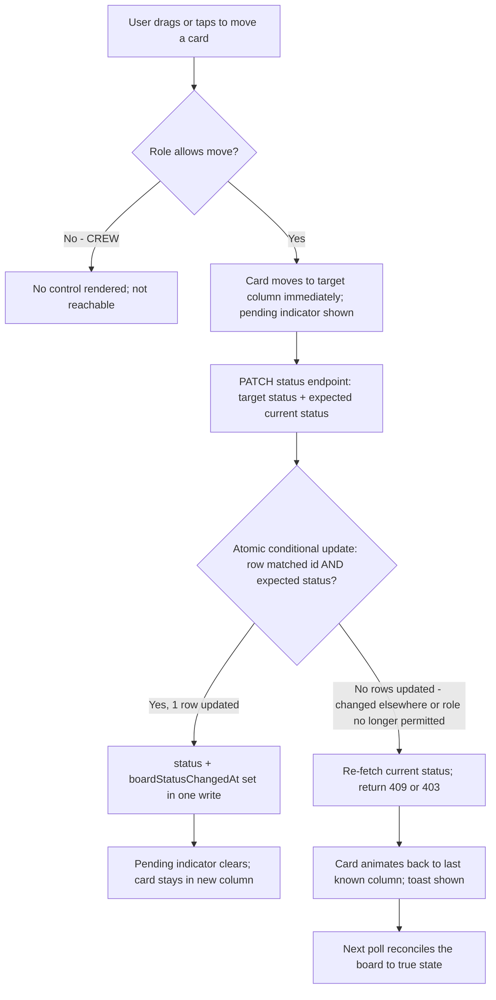

# feat: Active jobs Kanban board

**Origin:** `docs/brainstorms/2026-10-12-active-jobs-kanban-requirements.md`
**Date:** 2026-10-13
**Depth:** Standard

---

## Summary

Add a new "Board" page to the mmc-next portal: a three-column Kanban view (To Schedule / In Progress / Done) over existing work orders, with desktop drag-and-drop, mobile tap-to-advance, and a lightweight quick-create flow — replacing Mike's external Microsoft Planner scheduling. Built on the existing `WorkOrder` model and status enum, plus one small additive column (see Key Decisions) to track board-driven status changes correctly.

---

## Problem Frame

Mike currently schedules and tracks active work in Microsoft Planner, completely separate from mmc-next. Once scheduled there, someone has to separately create the matching work order record in mmc-next before a foreman can record the job's operational details. Keeping two systems in sync is the actual pain point this plan removes.

---

## Requirements

(Carried from the origin brainstorm; R-IDs preserved.)

**Board & Columns**
- R1. The board shows three columns mapped to `WorkOrder.status`: "To Schedule" (`DRAFT`), "In Progress" (`IN_PROGRESS`), "Done" (`COMPLETED`, scoped to recently board-completed jobs only — see Key Decisions and U2).
- R2. Work orders with status `INVOICED`, `PAID`, or `CANCELLED` do not appear on the board.
- R3. Each column shows a count of the jobs it contains.

**Job Creation**
- R4. A "+ New Job" control opens a quick-create form (customer, job type, foreman, scheduled date) and creates a new `DRAFT` work order, placed in "To Schedule".
- R5. The quick-create form only asks for enough to schedule and identify the job — full detail entry stays on the existing job edit page.

**Card Display & Navigation**
- R6. Each card shows at minimum: work order number, customer name, job type, assigned foreman, and scheduled date.
- R7. Clicking a card (outside its advance control) navigates to the existing job detail page.

**Status Changes**
- R8. On desktop, dragging a card to a different column updates the work order's status to match.
- R9. On touch devices, each card has a tap control that advances it to the next column (and a way to move it back) without requiring a drag gesture.
- R10. Status changes from the board use the same `status` field read everywhere else in the app.
- R11. `CREW`-role users can view the board but cannot move or advance cards; only `FOREMAN`, `MANAGER`, and `ADMIN` can change a job's status from the board.

---

## Key Decisions

- **The board becomes the sole owner of `DRAFT`/`IN_PROGRESS`/`COMPLETED` transitions.** Research found `PUT /api/jobs/[id]` (src/app/api/jobs/[id]/route.ts) currently re-derives `status` from `percentCompleted` on every save of the full job-edit form. Left in place, a later edit-form save could silently revert a board move (e.g., a foreman drags a job to "Done," then a subsequent form save flips it back to "In Progress" because `percentCompleted` is still 40%). This plan removes that auto-derivation entirely — the edit form preserves whatever status currently exists; the board is the only path that changes it. `percentCompleted` becomes a pure progress number with no status side effect.
- **A new, narrow status endpoint — not the existing full `PUT`.** `PUT /api/jobs/[id]` deletes and recreates every nested child record (time entries, payments, machines, crew details, materials, additional work, etc.) on each save — unsafe and semantically wrong for a one-field status change. The board calls a new endpoint that does a single scoped update, following the pattern already established by `src/app/api/jobs/[id]/costing/route.ts` (scoped `requireAuth`, direct `prisma.workOrder.update` with only the fields it owns, no transaction).
- **Conditional status updates, not blind overwrites — enforced atomically.** The status endpoint accepts the status the client expects to be moving *from*. If the work order's current status no longer matches (e.g., it was invoiced from the costing flow while the board was open elsewhere, or another user already moved it), the update is rejected with a 409 and the current state, rather than silently overwriting. This check-and-update must happen as a single atomic database operation (`updateMany` with both `id` and the expected status in the `WHERE` clause, branching on whether a row was actually updated) rather than a separate read followed by a write — a read-then-write gap would let two near-simultaneous moves both pass the check and the second write would silently clobber the first with no 409 ever firing, defeating the whole mechanism.
- **Drag is bidirectional and not restricted to adjacent columns.** Nothing in the codebase's costing/reporting logic depends on a job passing through "In Progress" before "Done," and the mobile tap control already allows moving backward as a correction. Desktop drag gets the same freedom for `FOREMAN`/`MANAGER`/`ADMIN` — dropping "Done" back onto "In Progress," or "To Schedule" straight to "Done," are both valid.
- **Foreman is optional on quick-create.** `WorkOrder.foremanId` is nullable in the schema and already handled as optional by the existing edit form. Quick-create follows the same rule — cards with no foreman show an "Unassigned" placeholder — consistent with keeping the creation form lightweight (R5).
- **Job type is the existing free-text field, not a category picker.** `WorkOrder.jobType` is a required `String`, distinct from the `jobCategory` enum used for filtering on the main jobs list. Quick-create collects `jobType` as free text (matching `src/app/api/landscape/work-orders/route.ts`'s existing quick-create precedent), not a dropdown.
- **Work order numbers auto-generate, with retry on collision.** The brainstorm's quick-create didn't account for `workOrderNumber` being required and globally unique (`@unique` in the schema). This plan reuses the existing `CW-NNNN` sequential-numbering pattern from `src/app/api/landscape/work-orders/route.ts`, but that pattern's read-max-then-increment approach has no protection against two concurrent creates computing the same next number — a real risk on a board where "+ New Job" is available to multiple simultaneous users, not just the single-admin flow it was originally written for. The new endpoint wraps the create in a bounded retry: on a unique-constraint violation, re-read the current max and retry (a few attempts, then fail loudly) rather than copying the existing pattern as a single unguarded attempt.
- **"Done" is scoped to recently board-completed jobs, via a dedicated timestamp — not the generic `updatedAt`.** A production data check during planning found 977 work orders currently in `COMPLETED` status — almost entirely bulk-imported historical records (`ZOHO`/`EXCEL_IMPORT`/legacy `MANUAL` entries), not jobs awaiting invoice today. An unscoped "Done" column would be dominated by that historical backlog. The original plan for this scoping relied on `updatedAt`, but `updatedAt` is a generic Prisma `@updatedAt` field that refreshes on *any* write to the row — including the costing flow, bulk-costing, and ordinary edit-form saves on a job that's already `COMPLETED` and not changing status at all. Relying on it would cause unrelated edits to resurrect old historical jobs into the Done column for another 30 days. Instead, the schema gains one small additive column, `boardStatusChangedAt` (nullable `DateTime`), set *only* by the new status endpoint whenever it actually changes a job's status. The Done column filters on this field being within the recent window; historical records (which never pass through the board) simply have it `null` and are correctly excluded forever, not just until the next unrelated write touches them.
- **Library choice: `@hello-pangea/dnd` for drag-and-drop.** No drag-and-drop library exists in this codebase today. Of the realistic options, `@hello-pangea/dnd` has the longest-proven, officially-supported React 19 compatibility (stable since Feb 2025, CI-tested against React 19) and its droppable-list model maps directly onto Kanban columns. The alternative, `@dnd-kit`, is either unmaintained on its stable line (no official React 19 support) or, on its actively-developed rewrite, carries an open, unresolved React 19 Strict Mode regression as of this plan's research.
- **Optimistic move with a pending indicator, not a wait-then-move.** This app's existing mutate-and-reconcile components (`PunchCard.tsx`, `ReceiptsSection.tsx`) wait for a successful API response before updating local state at all. A drag-and-drop board can't cleanly do the same thing: `@hello-pangea/dnd` (like any drag library) moves the card to its drop target as part of the drag gesture itself, so withholding that move until the network call resolves would mean the card visually snaps back after every successful drop, then re-appears — worse than either pure-optimistic or pure-wait-then-move. Instead, the card moves immediately (matching how every Kanban tool users already know behaves) but renders a brief pending indicator (dimmed + small spinner) until the server confirms; on success the indicator clears, on 409/403 the card animates back to its last known-good column with a toast. Mobile tap-to-advance follows the same pending/confirm/revert shape.
- **Lightweight polling keeps the board from going stale.** This is the app's first long-lived, client-rendered page — everywhere else, data is refetched by navigating to a fresh server-rendered page. The board instead polls its data on an interval and on window focus, so a job invoiced elsewhere (or moved by another user) disappears or reconciles without requiring a manual refresh.
- **Nav label is "Board," distinct from the existing "Active Jobs" page.** `/portal/landscape` is already labeled "Active Jobs" in the portal nav and serves a different purpose (a crew work-logging list for `DRAFT`/`IN_PROGRESS` jobs). That page is untouched by this plan; the new Kanban view gets its own nav entry and route.
- **Specific UI copy, decided now rather than left to the implementer.** Conflict/permission feedback: a 409 shows "This job was already updated — refreshing the board," a 403 shows "You don't have permission to move this job." An empty column shows muted placeholder text ("No jobs in To Schedule," etc.) rather than bare whitespace. A card with no scheduled date shows "Unscheduled," mirroring the existing "Unassigned" treatment for a missing foreman.

---

## High-Level Technical Design

The status-change path (desktop drag or mobile tap) is the one piece of this plan with real branching behavior — it's worth tracing explicitly, since it spans the client component, the new status endpoint, and the board's recovery behavior on conflict.

The same conditional-update contract also protects against the invoice-elsewhere race (AE4): if a job is invoiced via the costing flow while a board tab has it open, that tab's next move attempt hits the mismatch branch (E) rather than overwriting the financial status.

---

## Actors

- Mike / Admin — schedules jobs, creates new jobs directly from the board, assigns a foreman, moves cards as work progresses.
- Foreman — uses the board to see what's active, advances a job's status, then uses the existing job detail page to record crew hours, materials, and other specifics.
- Crew — views the board for visibility into active work; cannot move or advance cards.

---

## Key Flows

- F1. **Creating a job from the board**
  - **Trigger:** An admin/foreman/manager clicks "+ New Job".
  - **Steps:** Quick-create form opens → customer, job type, foreman (optional), and scheduled date entered → on submit, a new `DRAFT` work order is created with an auto-generated work order number and appears as a card in "To Schedule".
  - **Covered by:** R4, R5, R6

- F2. **Advancing a job's status on desktop**
  - **Trigger:** A user with move permission drags a card to another column.
  - **Steps:** Drop triggers a conditional status update on the underlying work order (expected current status must still match) → on success, the card settles in its new column; on conflict, the card re-syncs to its true current state with an inline notice.
  - **Covered by:** R8, R10

- F3. **Advancing a job's status on mobile**
  - **Trigger:** A user with move permission taps the advance (or revert) control on a card.
  - **Steps:** Same conditional status update as F2, triggered by tap instead of drag.
  - **Covered by:** R9, R10

- F4. **Jumping into job detail**
  - **Trigger:** A user taps/clicks a card body (not its advance control).
  - **Steps:** Navigates to the existing job detail page for that work order.
  - **Covered by:** R7

- F5. **Board staying in sync with changes made elsewhere**
  - **Trigger:** A work order's status changes outside the board (e.g., invoiced via the costing flow) while the board is open.
  - **Steps:** The board's periodic refetch (interval + window focus) picks up the change; a work order no longer in `DRAFT`/`IN_PROGRESS`/recent-`COMPLETED` drops off the board on the next refresh.
  - **Covered by:** R2

---

## Acceptance Examples

- AE1. **Covers R2.** Given a work order with status `INVOICED`. When the board loads or refreshes. Then that work order does not appear in any column.
- AE2. **Covers R9, R10.** Given a work order in "In Progress". When a user on a touch device taps the advance control on its card. Then the work order's status becomes `COMPLETED` and the card moves to "Done".
- AE3. **Covers R4, R5.** Given the quick-create form is submitted with only its required fields (customer, job type). When the new work order is created. Then it appears immediately in "To Schedule" with an auto-generated work order number, without the full job form having been completed.
- AE4. **Covers the conditional-update decision.** Given a work order is moved to `INVOICED` via the costing flow while a board tab has it open in "Done". When a user on that stale board tab tries to move the card. Then the request is rejected (409) and the card is removed from the board on the next refresh rather than the status being overwritten.
- AE5. **Covers R11.** Given a `CREW`-role user viewing the board. When they view any card. Then no drag handle or advance/revert control is rendered for them, and a direct API call to the status endpoint from that session is rejected regardless of UI state.

---

## Scope Boundaries

### In scope
- New Kanban board page with three status-mapped columns, counts, and recent-only "Done" scoping.
- New scoped status-update endpoint with conditional (expected-status) updates.
- Quick-create flow for new jobs directly from the board.
- Role-gated move/advance controls (`FOREMAN`/`MANAGER`/`ADMIN`; `CREW` view-only).
- Desktop drag-and-drop and mobile tap-to-advance/revert.
- Polling-based staleness handling.
- Removal of the existing edit form's `percentCompleted` → `status` auto-derivation.

### Deferred for later
- Importing/migrating existing cards from Microsoft Planner — Mike starts fresh; Planner is retired going forward.
- Manual reordering of cards within a column.
- Assigning crew members (beyond a single foreman) from the board.
- A calendar/date-range scheduling view as an alternative to status columns.
- Real-time (websocket) sync — polling is sufficient for this app's scale and matches its existing patterns.

---

## Dependencies / Assumptions

- Adds `@hello-pangea/dnd` as a new dependency (no existing drag-and-drop library in this codebase).
- Adds one small, additive schema change: a nullable `boardStatusChangedAt DateTime?` column on `WorkOrder`, set only by the new status endpoint. No backfill needed — existing records simply have it `null`, which correctly excludes them from the Done column's recency filter.
- Column labels ("To Schedule" / "In Progress" / "Done") are a default chosen without Mike's exact Planner column names on hand; confirm with Mike after launch and relabel if needed (presentation-only change, no backend impact).
- The 30-day "recent" window for the Done column is a starting default, now measured against `boardStatusChangedAt` rather than the generic `updatedAt` (see Key Decisions). Easy to tune later if Mike wants a shorter or longer window.

---

## Implementation Units

### U1. Status-update endpoint + remove auto-status-derivation from the job edit form

**Goal:** Give the board a safe, scoped way to change a work order's status, and eliminate the existing form behavior that could silently revert a board-driven status change.

**Requirements:** R8, R9, R10, R11; Key Decisions "board becomes sole owner," "new narrow endpoint," "conditional status updates."

**Dependencies:** None.

**Files:**
- `prisma/schema.prisma` — add `boardStatusChangedAt DateTime?` to `WorkOrder`
- `prisma/migrations/` — new migration for the additive column
- `src/app/api/jobs/[id]/status/route.ts` — new `PATCH` handler
- `src/app/api/jobs/[id]/route.ts` — modify `PUT` handler (remove `percentCompleted`-driven status derivation)
- `src/lib/constants.ts` — add `BOARD_MOVE_ROLES` constant

**Approach:**
- `PATCH /api/jobs/[id]/status` accepts `{ status, fromStatus }`. Authenticate with `requireAuth([...BOARD_MOVE_ROLES])` (`FOREMAN`, `MANAGER`, `ADMIN`).
- Validate `status` is one of `DRAFT`/`IN_PROGRESS`/`COMPLETED` only — the board never sets `INVOICED`/`PAID`/`CANCELLED` directly.
- Perform the conditional update atomically: `prisma.workOrder.updateMany({ where: { id, status: fromStatus }, data: { status, boardStatusChangedAt: new Date() } })`. If `result.count === 0`, no row matched both conditions — re-fetch the work order to report its actual current status and return 409 (or 404 if it no longer exists). This closes the race a separate findUnique-then-update would leave open: two near-simultaneous requests can't both pass the check, because the check and the write are the same database operation.
- `boardStatusChangedAt` is set explicitly here, and *only* here — this is what the Done-column recency filter (U2) relies on, deliberately distinct from the generic `updatedAt` that every other write touches too.
- In `jobs/[id]/route.ts`'s `PUT` handler, remove the `FINANCIAL_STATUSES`/`percentCompleted`-driven status block entirely; replace with simply preserving `existing.status` unchanged. The route no longer touches status at all — that responsibility now lives solely in the new endpoint.

**Patterns to follow:** `src/app/api/jobs/[id]/costing/route.ts` for the scoped-`requireAuth` shape. `src/lib/constants.ts`'s existing `RECEIPT_DELETE_ROLES` for the new role-constant pattern.

**Test scenarios:**
- `PATCH` with a valid `DRAFT → IN_PROGRESS` transition and matching `fromStatus` returns 200, updates `status`, and sets `boardStatusChangedAt`.
- `PATCH` where `fromStatus` doesn't match the work order's actual current status returns 409 with the current status in the response body, and does not modify the row.
- Two concurrent `PATCH` requests with the same stale `fromStatus` against the same job: exactly one succeeds (200), the other receives 409 — never both succeeding.
- `PATCH` attempting to set `status` to `INVOICED`/`PAID`/`CANCELLED` is rejected as invalid input (400).
- `PATCH` from a `CREW`-role session returns 403.
- `PATCH` from an unauthenticated session returns 401.
- `PATCH` for a non-existent work order id returns 404.
- After the `PUT` handler change: saving the full edit form with an unrelated field change (e.g., notes) leaves `status` and `boardStatusChangedAt` exactly as they were beforehand, regardless of `percentCompleted`'s value.

**Verification:** Manually drag/tap a job through all three board statuses and confirm the job-edit form's subsequent saves never change its status. Fire two conflicting updates concurrently (e.g., via two quick parallel requests) and confirm exactly one succeeds.

---

### U2. Board jobs API route — list (with recent-Done scoping) and quick-create

**Goal:** One API route the board's client component polls for live data, and through which new jobs are created.

**Requirements:** R1, R2, R3, R4, R5; Key Decisions on recent-Done scoping, optional foreman, free-text job type, auto-generated work order numbers.

**Dependencies:** None.

**Files:**
- `src/app/api/board/jobs/route.ts` — new `GET` (list) and `POST` (quick-create) handlers
- `src/lib/board.ts` — new shared serializer (`toBoardJobDTO`), mirroring `src/lib/receipts.ts`'s `toReceiptDTO` pattern

**Approach:**
- `GET`: authenticate with `requireAuth()` (any authenticated role, including `CREW` — view access is unrestricted per R11; only move/advance is role-gated). Query `WorkOrder` where `status IN (DRAFT, IN_PROGRESS)` OR (`status = COMPLETED` AND `boardStatusChangedAt >= now() - 30 days`), including `customer` and `foreman`. Serialize each via `toBoardJobDTO`, which must select only safe, specific fields from the nested relations — `customer.name`, `foreman.id`/`foreman.name` — rather than passing through the full Prisma relation objects. (`Employee` carries `passwordHash`; spreading a full `foreman` include into a JSON response, as the existing `jobs/[id]/route.ts` GET currently does for its own purposes, would ship it to every browser polling the board.)
- `POST`: validate body with a Zod schema requiring `customerId` and `jobType`; `foremanId` and `projectStartDate` optional. Auto-generate the work order number using the `CW-NNNN` sequential-lookup pattern from `src/app/api/landscape/work-orders/route.ts`, wrapped in a bounded retry: on a unique-constraint violation (Prisma P2002) from a concurrent create claiming the same number, re-read the current max and retry (a few attempts) before failing. Create with `status: "DRAFT"`. `requireAuth()` (any authenticated role can create — see the Open Questions note on whether this should instead match `BOARD_MOVE_ROLES`).

**Patterns to follow:** `src/app/api/landscape/work-orders/route.ts` for quick-create + WO-number generation. `src/lib/receipts.ts` for the DTO-serializer pattern (field-level selection, not object spreading).

**Test scenarios:**
- `GET` returns work orders with status `DRAFT` or `IN_PROGRESS` regardless of age.
- `GET` returns `COMPLETED` work orders only when `boardStatusChangedAt` is within the recent window; excludes older `COMPLETED` records and any `COMPLETED` record where `boardStatusChangedAt` is null (i.e., never board-managed).
- `GET` excludes `INVOICED`/`PAID`/`CANCELLED` entirely.
- `GET` response does not include `passwordHash` or any other `Employee` field beyond `id`/`name` for the foreman relation.
- `GET` from an unauthenticated session returns 401.
- `POST` with only `customerId` and `jobType` succeeds, auto-assigns the next `CW-NNNN` number, and sets `status: DRAFT`.
- `POST` without `customerId` or without `jobType` returns 400.
- `POST` with a non-existent `customerId` returns an appropriate error (400/404 per existing convention).
- Two concurrent `POST` requests each get distinct, non-colliding work order numbers (verify the retry path actually fires under a simulated collision, not just that it's absent under low concurrency).

**Verification:** Create a job via the endpoint and confirm it's returned by the subsequent `GET`. Confirm a manually-marked-`INVOICED` job (via the existing costing flow) stops appearing in `GET` results. Inspect a raw `GET` response and confirm no password hash or other sensitive `Employee` field is present.

---

### U3. Quick-create UI (new-job sheet)

**Goal:** The "+ New Job" form the board renders, wired to U2's create endpoint.

**Requirements:** R4, R5, R6.

**Dependencies:** U2.

**Files:**
- `src/components/portal/board/NewJobSheet.tsx` — new client component

**Approach:**
- A `Sheet`-based form (matching `ReceiptsSection.tsx`'s mobile-first `Sheet` pattern, side="bottom"), with fields: customer `Select`, job type text `Input`, foreman `Select` (optional, includes an "Unassigned" option), scheduled date `Input` (optional).
- On submit, `POST` to the U2 endpoint; on success, hand the created job back to the parent board component to insert into "To Schedule" locally (no full refetch needed); on failure, show an inline error matching the existing `error`/`AlertCircle` convention.
- Reuse the `MobileSelect`/`Field` helpers from `src/components/portal/work-order-form/form-ui` if their shape fits, rather than hand-rolling new field wrappers.

**Patterns to follow:** `src/components/portal/ReceiptsSection.tsx`'s Sheet-based add flow (form state, submit handler, error display).

**Test scenarios:**
- Submitting with only required fields (customer, job type) succeeds and the sheet closes.
- Submitting without a customer or without a job type shows a validation error and does not submit.
- A successful submission is reflected in the board's "To Schedule" column without a page reload.
- A failed submission (e.g., simulated 500) shows an inline error and leaves the sheet open with entered values intact.

**Verification:** Open the sheet, create a job with minimal fields, confirm it appears in "To Schedule" immediately.

---

### U4. Kanban board client component

**Goal:** The drag-and-drop / tap-to-advance board itself — columns, cards, role-gated controls, and staleness polling.

**Requirements:** R1, R2, R3, R6, R7, R8, R9, R10, R11; Key Decisions on bidirectional drag, optimistic move with pending indicator, polling.

**Dependencies:** U1, U2, U3.

**Files:**
- `src/components/portal/board/JobBoard.tsx` — new client component
- `src/components/portal/board/JobCard.tsx` — new client component (card rendering)
- `package.json` — add `@hello-pangea/dnd`

**Approach:**
- `JobBoard` wraps the three columns in `@hello-pangea/dnd`'s `DragDropContext`, one `Droppable` per status column, one `Draggable` per card.
- Local state holds the column-keyed job lists, seeded from the server-rendered initial props (from U5) and refreshed by polling the U2 `GET` endpoint on an interval and on window focus; reconcile by replacing the relevant column's contents rather than a full remount. If a poll request fails, retry silently on the next scheduled interval; after several consecutive failures, show a small non-blocking "Unable to refresh" indicator rather than failing silently forever.
- On `onDragEnd` (or a tap-advance/revert): if the destination column differs from the source, move the card locally right away (matching standard drag-and-drop feel) with a pending indicator (dimmed + small spinner), then call the U1 status endpoint with the job's current status as `fromStatus` and the destination column's status as the target. On success, clear the pending indicator. On 409 or 403, animate the card back to its last known-good column and show a toast ("This job was already updated — refreshing the board." / "You don't have permission to move this job."); the next poll resyncs the board to true state regardless.
- `JobCard` renders work order number, customer, job type, foreman ("Unassigned" when null), and scheduled date ("Unscheduled" when null). For `FOREMAN`/`MANAGER`/`ADMIN`, renders a drag handle plus an advance/revert tap control (for mobile); for `CREW`, renders neither, and the board header shows a small "View only" label for CREW sessions so the restriction reads as intentional rather than broken. The card is otherwise identical for all roles and still links to job detail (F4).
- Each column renders a muted empty-state message ("No jobs in To Schedule," etc.) when it has zero cards, rather than bare whitespace below the header/count.
- `BOARD_MOVE_ROLES` constant (from U1) gates rendering of drag handles and tap controls, mirroring `ReceiptsSection`'s `canDelete` pattern.

**Patterns to follow:** `src/components/portal/ReceiptsSection.tsx` and `src/app/portal/time/PunchCard.tsx` for loading/error state conventions (adapted here to an optimistic-with-rollback shape rather than their fetch-then-update shape, per the Key Decision above). `src/components/portal/StatusBadge.tsx` for status-color conventions if reused for column headers.

**Test scenarios:**
- Dragging a card to a different column moves it locally immediately, shows a pending indicator, and calls the status endpoint with the correct `fromStatus`/target `status` pair.
- A 409 response animates the card back to its original column, clears the pending indicator, and shows the "already updated" toast.
- A 403 response does the same with the permission-denied toast.
- A `CREW`-role user sees no drag handle or advance/revert control on any card, and sees the "View only" board-level indicator.
- A card with no foreman renders "Unassigned"; a card with no scheduled date renders "Unscheduled".
- An empty column renders its muted empty-state message instead of blank space.
- Clicking a card's body (not its advance control) navigates to the job detail page for that work order.
- Polling removes a card from the board after its status changes to `INVOICED` elsewhere (simulate via direct DB/API update between polls).
- Backward and skip-column drags (e.g., "Done" → "In Progress", "To Schedule" → "Done") are accepted for permitted roles.
- Several consecutive simulated poll failures surface the "Unable to refresh" indicator; a subsequent successful poll clears it.

**Verification:** Exercise the board as each role (`ADMIN`, `FOREMAN`, `CREW`) and confirm move affordances appear/disappear correctly; drag a card through all three columns and back; confirm the full job-edit form's status is unaffected by subsequent saves after a board move (cross-check with U1's verification).

---

### U5. Board page and navigation entry

**Goal:** Wire the board into the portal as a new route, with initial server-rendered data.

**Requirements:** R1, R2, R3; Key Decision on nav naming.

**Dependencies:** U4.

**Files:**
- `src/app/portal/board/page.tsx` — new server component
- `src/components/portal/PortalShell.tsx` — add nav entry

**Approach:**
- Server component fetches the same job set as U2's `GET` (or calls the same query logic directly, avoiding an internal HTTP round-trip), serializes via `toBoardJobDTO`, and passes the result plus `session.user.role` into `JobBoard` as initial props — mirroring how `jobs/[id]/page.tsx` passes `userRole` into `ReceiptsSection`.
- Add a new nav entry labeled "Board" (not "Active Jobs," to avoid colliding with the existing `/portal/landscape` entry), placed near the top level given the broad (office/foreman/crew) audience.

**Patterns to follow:** `src/app/portal/jobs/[id]/page.tsx`'s session-fetch-and-pass-to-client-component shape.

**Test scenarios:**
- Page loads without error and renders the three columns with correct initial counts.
- Page is reachable from the new "Board" nav entry for all roles; nav entry does not appear duplicated under the existing "Active Jobs" section.

**Verification:** Load `/portal/board` as each role and confirm the page renders with live data matching a direct DB check of current `DRAFT`/`IN_PROGRESS`/recent-`COMPLETED` counts.

---

## Open Questions

**Deferred to planning (resolved above)** — the brainstorm's two deferred questions were resolved during this planning pass: column labels are a confirmed-default placeholder pending Mike's sign-off (see Dependencies/Assumptions), and quick-create's fields are customer/job type/foreman/date with auto-generated work order numbers.

**Raised during document review — need a decision before implementation:**

- **Should quick-create (`POST /api/board/jobs`) be restricted to `BOARD_MOVE_ROLES` instead of any authenticated role?** As currently scoped, a `CREW`-role session could create new work orders from the board, even though the origin brainstorm frames Crew as strictly view-only and never grants job-creation rights. The existing `src/app/api/landscape/work-orders/route.ts` precedent this plan followed is also unrestricted, but that route predates the board's broader, lower-trust audience. Default if undecided: restrict creation to `BOARD_MOVE_ROLES`, matching the move/advance restriction, since nothing in the origin doc asked for crew to create jobs.
- **Is the polling + conditional-update conflict-handling subsystem worth its complexity at current scale?** Production data shows only ~70 `DRAFT` and ~9 `IN_PROGRESS` work orders today — a small, low-concurrency surface. This plan builds a real mechanism for it anyway (interval + focus polling, atomic conditional updates, 409 reconciliation, toasts) because the underlying correctness problem (silently overwriting a status set elsewhere, e.g. by the costing flow) is real regardless of how often it's actually hit — the atomic conditional-update fix is cheap and worth keeping regardless of this decision. The genuinely optional part is the *polling* half: if this is judged overkill for current usage, a simpler fallback (refetch after each of the board's own actions, no standing interval timer) would reduce the new-pattern surface at the cost of not catching external changes (e.g., a job invoiced elsewhere) until the next manual page load.
- **Is removing `percentCompleted`-driven auto-status from the job edit form acceptable as a global behavior change?** This fixes a real bug (a board-set status could otherwise be silently reverted by the next unrelated edit-form save), but it changes existing behavior for every user of the full edit form, not just board users — anyone currently relying on bumping `percentCompleted` to 100 as their way of marking a job `COMPLETED` would need to switch to using the board instead. Worth confirming with Mike before shipping, since it's a visible workflow change for people who may never touch the new board.
