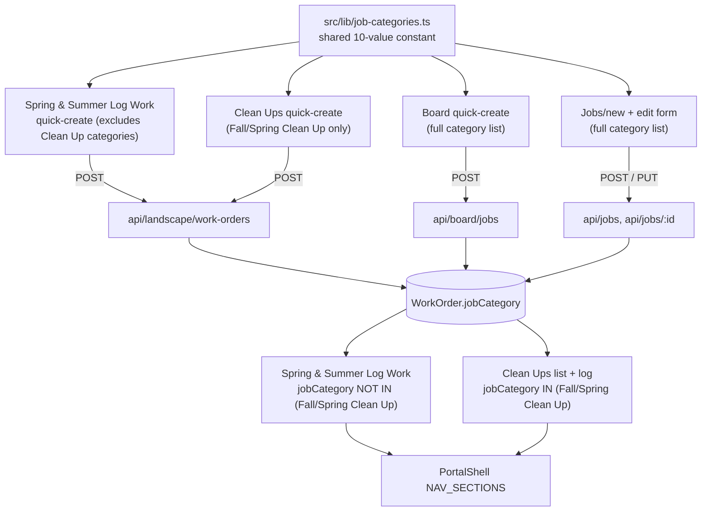

# feat: Portal sidebar reorg — season-aligned sections + job-category fix

## Summary

Replace the portal sidebar's domain-based sections (Landscaping, Snow Removal, Fleet) with season-aligned ones — Spring and Summer, Clean Ups, Winter — while consolidating Active Jobs into Log Work, Job Costing into Bulk Costing (via tabs), and Fleet into Admin. All of it depends on fixing a real, pre-existing gap: none of the app's job-creation or job-edit paths currently persist a job's category, so this plan adds that everywhere first, then builds the season split on top of it.

## Problem Frame

(see origin: `docs/brainstorms/2026-10-14-portal-sidebar-reorg-requirements.md`) The sidebar's structural problem and the `jobCategory` data gap are both covered there. One correction from this plan's research: the brainstorm describes the gap as leaving `jobCategory` "null," but the Prisma column actually defaults to `OTHER` (`@default(OTHER)`). Every job created today silently lands as `OTHER` rather than vanishing — a real but less severe failure mode. `OTHER` falls under Spring and Summer's catch-all, so a newly-created Fall Clean Up job would incorrectly surface there instead of under Clean Ups until this plan's fix lands.

---

## Key Technical Decisions

- **One shared job-category constant, derived from the Prisma enum — not hand-typed, not five.** `src/lib/job-categories.ts` derives its value list from `Object.values(JobCategory)` (imported from `@prisma/client`), pairing each with a display label, rather than hand-typing the 10 strings. This matches the existing `WorkOrderStatus`-import convention already used elsewhere in the codebase and means a future Prisma migration that adds an 11th category can't silently go unexposed in the UI. Four existing files each hand-roll this same list today (`ActiveWorkOrders.tsx`, `CrewWorkLogForm.tsx`, `JobsToolbar.tsx`, `costing/bulk/page.tsx`); this plan replaces all four. `src/lib/constants.ts`'s existing `JOB_CATEGORIES` (19 values) uses a completely different, unrelated vocabulary and zero code currently references it for an actual `jobCategory` write — it is explicitly **not** touched or reused by this work.
- **`jobCategory` is required everywhere it's collected, including on edit.** Rather than inventing separate required-on-create / optional-on-edit validation, the field is simply required in every schema that accepts it. This imposes no extra friction on edits — the edit form always pre-fills the job's existing category, so there's never a genuinely empty value to block on. Only real job creation (where no value exists yet) forces an active choice, which matches how `customerId` and the job description already behave in these forms.
- **Season-scoped quick-create forms only offer categories that keep the job in the view it was created from.** Spring and Summer's Log Work quick-create excludes Fall/Spring Clean Up (picking one there would make the job immediately vanish from the page you just created it on); Clean Ups' quick-create offers only Fall Clean Up and Spring Clean Up. The Board's quick-create and the full Jobs/new form aren't season-scoped, so they keep the full 10-value list.
- **The quick-create widget is extracted into one reusable component, not duplicated a second time.** `ActiveWorkOrders.tsx`'s existing quick-create form (customer, category, description) is generalized into a shared component taking a `categoryOptions` prop and an `onCreated` callback, reused by both Clean Ups' list page and Spring and Summer's Log Work page.
- **Clean Ups mirrors the pre-merge Active-Jobs-plus-Log-Work shape; Spring and Summer gets the new merged shape.** The origin brainstorm asks for Clean Ups to have its own list *and* log-work pages (R6) while Active Jobs merges away entirely for the general section (R10). This plan honors that asymmetry rather than normalizing both to the same shape — Clean Ups is the smaller, newer surface and benefits from the simpler two-page pattern; Spring and Summer is the long-established high-traffic one and benefits from the consolidation.
- **Costing and Bulk Costing merge via tabs that switch which component renders, not via shared URL state.** `src/app/portal/costing/page.tsx` is a Server Component reading `?tab=`; `src/app/portal/costing/bulk/page.tsx` is a Client Component whose `year`/`category`/`status`/`page`/`uncosted` filters are plain `useState` with no URL wiring today — it was never bookmarkable or shareable via its filters. Rather than retrofitting URL-param threading between two components with different rendering models, the merge only uses `?tab=` to pick which one renders; Bulk Costing keeps its existing self-contained client-side state exactly as it is today. This is simpler than the original "carry `year` across tabs" idea and ships none of the Server/Client boundary work that would otherwise require.
- **Bulk Costing's tab switch is guarded against losing unsaved edits.** Confirmed in code: the bulk editor batches row edits in local state and only persists them via an explicit "Save All Changes" button — there is no autosave. Switching tabs away from Bulk Edit while dirty rows exist must block or confirm the navigation rather than silently discarding the edits.
- **Jobs, Materials, All Customers, Breakdown, and Costing stay company-wide — they are not season-filtered.** The origin brainstorm's R5 asked for the Jobs/Breakdown/Costing views to also exclude Clean Up categories, but this plan's own Scope Boundaries deliberately gives Clean Ups no dedicated financial reporting of its own — if the shared Costing/Breakdown views also excluded Clean Up jobs, there would be no view anywhere in the app showing Clean Ups' financial data at all. Only Log Work (job-logging, not reporting) and Clean Ups' own pages apply the category filter; the shared company-wide views remain the single source of truth for financial and job-list data across every category. This is a deliberate, reasoned divergence from the origin brainstorm's literal R5, not an oversight.
- **Old bookmarkable routes redirect, they don't 404.** `/portal/landscape` → `/portal/landscape/log`; `/portal/costing/bulk` → `/portal/costing?tab=bulk`.
- **Subcontractor-categorized jobs default to Spring and Summer**, not a bucket of their own — consistent with how the historical data already treats them (general landscaping work performed by a subcontractor, not a distinct season).

---

## Requirements

**Job categorization integrity**

- R1. Every job-creation and job-edit path — the Board's quick-create, Spring and Summer's Log Work quick-create, Clean Ups' quick-create, and the full Jobs/new-and-edit form — persists a real `jobCategory` value, not only the free-text job description.
- R2. `ActiveWorkOrders.tsx`'s quick-create form, whose "Job Type" dropdown today selects from a category-shaped list but writes the result into the free-text `jobType` field, is split into a proper category selector (writes `jobCategory`) and a separate free-text description field (writes `jobType`).
- R3. The job edit form (`JobInfoSection.tsx`, shared with create via `WorkOrderForm.tsx`) gains the same category selector, pre-filled with the job's current category; `PUT /api/jobs/[id]` persists changes to it.
- R4. One shared constant (`src/lib/job-categories.ts`) replaces the four existing scattered duplicate category lists; `src/lib/constants.ts`'s unrelated, unused 19-value `JOB_CATEGORIES` is left alone.

**Sidebar structure**

- R5. The sidebar's "Landscaping" and "Snow Removal" sections are replaced with three season-aligned sections: Spring and Summer (general landscaping work), Clean Ups (Fall and Spring Clean Up jobs), and Winter (renamed from Snow Removal, same underlying pages, unchanged).
- R6. Clean Ups is a new section with its own list page (including its own quick-create, scoped to Fall/Spring Clean Up categories) and its own log-work page, both filtered to `jobCategory IN (FALL_CLEANUP, SPRING_CLEANUP)`, built on the existing `WorkOrder` model.
- R7. Spring and Summer's Log Work page excludes `jobCategory IN (FALL_CLEANUP, SPRING_CLEANUP)` from its job list and its quick-create's category options. The shared Jobs, Materials, All Customers, Breakdown, and Costing views remain company-wide and are **not** category-filtered (see Key Technical Decisions for why this diverges from the origin brainstorm's broader framing).
- R8. Historical work orders (2698 total: 1342 Landscape, 819 Other, 328 Fall Clean Up, 143 Spring Clean Up, 66 Subcontractor) require no migration or re-categorization to appear correctly.

**Consolidation**

- R9. Active Jobs (`/portal/landscape`) merges into Log Work (`/portal/landscape/log`): the quick-create affordance and the category-exclusion filter move onto the Log Work page; the standalone Active Jobs list page is removed; `/portal/landscape` redirects to `/portal/landscape/log`.
- R10. Job Costing and Bulk Costing merge into one "Costing" nav entry, implemented as tabs (Summary / Bulk Edit) on `/portal/costing` via a `?tab=` query param; `/portal/costing/bulk` redirects to `/portal/costing?tab=bulk`.
- R11. The one-item "Fleet" section folds into "Admin" (its Maintenance link moves there); the "Fleet" section is removed.

**Unaffected**

- R12. Board and Reports are unchanged.
- R13. Role-based visibility (the existing `adminOnly` gating) stays exactly as it is today — only destinations and grouping change.

---

## High-Level Technical Design

---

## Implementation Units

### U1. Shared job-category constant

**Goal:** One source of truth for the 10-value `JobCategory` list, replacing four scattered duplicates.

**Requirements:** R4

**Dependencies:** None

**Files:**
- `src/lib/job-categories.ts` — new. Derives its value list from `Object.values(JobCategory)` (imported from `@prisma/client`) rather than hand-typing the 10 strings, pairing each with a `{ value, label }` shape (reuse the existing `formatCategory`-style label logic already present in `ActiveWorkOrders.tsx`).
- `src/components/portal/landscape-form/ActiveWorkOrders.tsx` — modify: remove local `JOB_CATEGORIES`, import from the new constant.
- `src/components/portal/landscape-form/CrewWorkLogForm.tsx` — modify: same.
- `src/app/portal/jobs/JobsToolbar.tsx` — modify: same.
- `src/app/portal/costing/bulk/page.tsx` — modify: same.

**Approach:** Pure refactor — no behavioral change. Each file's local list is checked against the new shared constant for exact value parity before removal (the four existing lists already match the real Prisma enum; only the unrelated `constants.ts` list is a mismatch, and it is not touched).

**Patterns to follow:** Existing `formatCategory`/label-formatting helper in `ActiveWorkOrders.tsx`.

**Test scenarios:** Test expectation: none — pure refactor, no behavioral change. Verification is that the four call sites render identically before and after.

**Verification:** The four consuming files import from `src/lib/job-categories.ts` and no longer declare their own local list; the Jobs list filter, the bulk-costing filter, and both quick-create dropdowns render the same options as before.

---

### U2. `jobCategory` persistence — schemas and API routes

**Goal:** Every route that creates or updates a `WorkOrder` accepts and persists `jobCategory`.

**Requirements:** R1, R3

**Dependencies:** U1

**Files:**
- `src/lib/schemas.ts` — modify: add a required `jobCategory` field (enum-validated against U1's constant) to `workOrderBodySchema`.
- `src/app/api/jobs/route.ts` — modify: pass `jobCategory` through to the `WorkOrder` create call.
- `src/app/api/jobs/[id]/route.ts` — modify: pass `jobCategory` through to the `WorkOrder` update call (PUT).
- `src/app/api/landscape/work-orders/route.ts` — modify: add `jobCategory` to its inline `quickCreateSchema` and the create call.
- `src/app/api/board/jobs/route.ts` — modify: add `jobCategory` to its inline `quickCreateSchema` and the create call.

**Approach:** Backend-first sequencing so U3's UI work has a working API to submit to immediately. **This unit is not independently shippable: the instant `jobCategory` becomes required in `workOrderBodySchema` and the two inline quick-create schemas, every existing form submission to all four routes starts failing validation with a 400, since no UI sends the field until U3 wires the forms.** U2 and U3 must land in the same deploy — do not merge or deploy U2 alone.

**Test scenarios:**
- Happy path: `POST /api/jobs` with a valid `jobCategory` creates a work order with that category. Covers R1.
- Happy path: `PUT /api/jobs/[id]` with a changed `jobCategory` updates the existing work order's category. Covers R3.
- Happy path: `POST /api/landscape/work-orders` and `POST /api/board/jobs` each with a valid `jobCategory` create a work order with that category. Covers R1.
- Error path: any of the four routes reject a request missing `jobCategory` or with a value outside the 10-value enum, with a 400 and a clear message (matching the existing `customerId`/`jobType` validation-error shape).

**Verification:** Each route's response includes the persisted `jobCategory`, and a direct read of the created/updated row confirms it matches what was submitted.

---

### U3. Category selectors in the creation and edit UIs

**Goal:** Every form that creates or edits a job lets the user pick a category, wired to U2's now-ready API.

**Requirements:** R1, R2, R3

**Dependencies:** U1, U2

**Files:**
- `src/components/portal/landscape-form/ActiveWorkOrders.tsx` — modify: split the existing "Job Type" `MobileSelect` into a category `MobileSelect` (sourced from U1, options excluding Fall/Spring Clean Up per the season-scoping decision) and a new, separate free-text description `MobileInput`; submit both `jobCategory` and `jobType`.
- `src/components/portal/board/NewJobSheet.tsx` — modify: add a category `MobileSelect` (full U1 list) alongside the existing free-text job-type input; submit both fields.
- `src/components/portal/work-order-form/JobInfoSection.tsx` — modify: add a category selector (full U1 list), pre-filled with the work order's current category when editing.
- `src/components/portal/work-order-form/WorkOrderForm.tsx` — modify: `JobInfoSection` is purely presentational and holds no state of its own — `jobType`/`setJobType` are controlled props owned by this parent, which also builds the exact JSON body sent to `POST /api/jobs` and `PUT /api/jobs/[id]`. Add `jobCategory`/`setJobCategory` state here, following the same `useState` + prop-pass-through pattern already used for `jobType`, and include `jobCategory` in the submitted body.
- `src/components/portal/work-order-form/types.ts` — modify: add a `jobCategory` field to `WorkOrderInitialData`.
- `src/app/portal/jobs/[id]/edit/page.tsx` — modify: select `jobCategory` from Prisma and pass it through as part of `initialData`.

**Approach:** Follow the existing `Field` + `MobileSelect` convention used throughout `form-ui.tsx` consumers — a labeled field wrapping a select populated from an options array, with a placeholder first option only where genuinely optional (not applicable here, since category is required). For `JobInfoSection.tsx` specifically, the new selector is wired the same way the existing `jobType` field already is — state lives in `WorkOrderForm.tsx`, not in `JobInfoSection.tsx` itself.

**Test scenarios:**
- Happy path: submitting `ActiveWorkOrders.tsx`'s quick-create with a category and a description creates a job with both fields set correctly. Covers R2.
- Happy path: submitting the Board's quick-create with a category creates a job with that category. Covers R1.
- Happy path: editing an existing job via `JobInfoSection.tsx`, changing only the category, saves the new category without altering other fields. Covers R3.
- Edge case: `ActiveWorkOrders.tsx`'s category selector does not offer Fall Clean Up or Spring Clean Up as options (season-scoping). Covers R7 (selector half).
- Error path: submitting any of the three forms without selecting a category is blocked client-side the same way missing customer/description already is today.

**Verification:** Each of the three forms visibly includes a category selector; creating or editing a job through any of them results in the correct `jobCategory` on the resulting row (spot-checked against U2's API behavior).

---

### U4. Clean Ups section — new pages

**Goal:** A new, self-contained Clean Ups domain: a list page with its own quick-create, and a log-work page — both scoped to Fall/Spring Clean Up jobs.

**Requirements:** R6

**Dependencies:** U1, U2, U3

**Files:**
- `src/app/portal/cleanups/page.tsx` — new. Mirrors `src/app/portal/landscape/page.tsx`'s structure (server component, fetches `WorkOrder` where `status IN (DRAFT, IN_PROGRESS)` AND `jobCategory IN (FALL_CLEANUP, SPRING_CLEANUP)`), renders `CleanUpsWorkOrderList` below.
- `src/app/portal/cleanups/log/page.tsx` — new. Mirrors `src/app/portal/landscape/log/page.tsx` (reads `?wo=`, fetches the same filtered work-order set, materials, employees), renders `CrewWorkLogForm` with a `defaultWorkOrderId`.
- `src/components/portal/landscape-form/ActiveWorkOrders.tsx` — modify: extract its quick-create form (customer select, category select, description input, submit) into a new shared component (`src/components/portal/landscape-form/JobQuickCreate.tsx`) accepting `categoryOptions` and `onCreated` props, used by both this unit and U5.
- `src/components/portal/landscape-form/CleanUpsWorkOrderList.tsx` — new. Owns the Clean Ups work-order list's client state (seeded from server props), renders `JobQuickCreate` (category options restricted to Fall/Spring Clean Up) plus the list/status-badge/"Log" link UI and empty state, mirroring `ActiveWorkOrders.tsx`'s current list-rendering responsibilities — the only part of that component not already covered by the `JobQuickCreate` extraction. `ActiveWorkOrders.tsx` is deleted in U5, so this component is Clean Ups' sole home for that logic. Uses Clean-Ups-specific empty-state copy (e.g. "No active clean-up jobs") rather than reusing the general landscaping list's wording verbatim.

**Approach:** Copy the existing Active-Jobs-plus-Log-Work pattern as closely as possible rather than inventing new UI shapes — the only material difference is the `jobCategory` filter, the restricted category options passed into the shared quick-create component, and the season-specific empty-state copy.

**Test scenarios:**
- Happy path: the Clean Ups list page shows only `DRAFT`/`IN_PROGRESS` work orders with `jobCategory` in Fall or Spring Clean Up. Covers R6.
- Happy path: creating a job via Clean Ups' quick-create with a Fall Clean Up or Spring Clean Up category succeeds and the new job appears in the list without a reload. Covers R6, R1.
- Edge case: Clean Ups' quick-create offers only Fall Clean Up and Spring Clean Up as category options — no other category is selectable from this entry point.
- Integration: navigating from Clean Ups' list to its log-work page via a job's "Log" link pre-selects that job in `CrewWorkLogForm`, consistent with the existing `?wo=` deep-link behavior.

**Verification:** A Fall-Clean-Up-categorized job created anywhere in the app appears under Clean Ups and nowhere under Spring and Summer; the reverse holds for a Landscape-categorized job.

---

### U5. Merge Active Jobs into Log Work

**Goal:** Spring and Summer's job-creation and job-browsing role, currently split across Active Jobs and Log Work, collapses into Log Work alone.

**Requirements:** R7, R9

**Dependencies:** U1, U2, U3, U4 (reuses U4's extracted `JobQuickCreate` component)

**Files:**
- `src/app/portal/landscape/log/page.tsx` — modify: add `jobCategory NOT IN (FALL_CLEANUP, SPRING_CLEANUP)` to its existing `WorkOrder` query; render `JobQuickCreate` (from U4) above or beside the existing job selector, with category options excluding Fall/Spring Clean Up.
- `src/components/portal/landscape-form/CrewWorkLogForm.tsx` — modify: accept newly-created jobs appended to its work-order list without a page reload, and auto-select the newly-created job in its selector.
- `src/app/portal/landscape/page.tsx` — delete (its list-browsing and quick-create roles are now served by the log-work page and Clean Ups respectively).
- `src/components/portal/landscape-form/ActiveWorkOrders.tsx` — delete (fully superseded by U4's `JobQuickCreate` extraction).
- A redirect from `/portal/landscape` to `/portal/landscape/log` (Next.js route-level redirect, e.g. via `redirect()` in a minimal `page.tsx` left at the old path, or `next.config.ts` redirects).

**Approach:** The job-picker role Active Jobs served is already redundant with `CrewWorkLogForm`'s own selector (confirmed in research); only the list-browsing view and the quick-create affordance need an explicit new home, and quick-create is the only one of the two actually requested (R9 only asks for the create role to move, not the browsing view — anyone wanting to browse jobs still has the existing "Jobs" page).

**Test scenarios:**
- Happy path: Log Work's job selector no longer offers Fall/Spring Clean Up jobs. Covers R7.
- Happy path: creating a job via Log Work's quick-create immediately appears, pre-selected, in the job selector — no reload required. Covers R9.
- Integration: visiting `/portal/landscape` redirects to `/portal/landscape/log`. Covers R9.
- Error path: Log Work's quick-create category selector cannot select Fall Clean Up or Spring Clean Up.

**Verification:** `/portal/landscape` no longer exists as a standalone page; Log Work shows the quick-create affordance and a correctly-filtered job selector; the old URL redirects rather than 404s.

---

### U6. Costing + Bulk Costing merge via tabs

**Goal:** One "Costing" nav entry serving both the read-only summary and the bulk editor, as tabs.

**Requirements:** R10

**Dependencies:** U1 (also modifies `costing/bulk/page.tsx` — must land after U1's edit to that file, or the bulk editor's category list reverts to a local duplicate)

**Files:**
- `src/app/portal/costing/page.tsx` — modify: add a tab bar (Summary / Bulk Edit) reading `?tab=`, mirroring `src/app/portal/reports/page.tsx`'s existing tab pattern; render the existing dashboard content under the Summary tab, and render `BulkCostingView` (see below) under the Bulk Edit tab.
- `src/app/portal/costing/bulk/page.tsx` — modify: export its existing content as a `BulkCostingView` client component for `costing/page.tsx` to render under the Bulk Edit tab. Its `year`/`category`/`status`/`page`/`uncostedOnly` filters remain exactly what they are today — local `useState` with no URL wiring — since they never had URL state to begin with; the tab switch only changes which component renders, nothing is threaded between tabs.
- A redirect from `/portal/costing/bulk` to `/portal/costing?tab=bulk`.

**Approach:** The two views have genuinely different rendering models — `costing/page.tsx` is a Server Component reading `searchParams`, `costing/bulk/page.tsx` is a Client Component with purely local filter state and no `useSearchParams`/URL wiring today. Rather than retrofitting URL-param parity between them (a bigger, undocumented change), `?tab=` only selects which component renders; `BulkCostingView` keeps its current self-contained behavior unchanged. Switching tabs away from Bulk Edit while dirty rows exist (confirmed: the bulk editor batches edits locally and only persists them via an explicit "Save All Changes" button, no autosave) must block or confirm the navigation rather than silently discarding the edits.

**Test scenarios:**
- Happy path: the Summary tab renders the existing dashboard unchanged; the Bulk Edit tab renders `BulkCostingView` unchanged, each reachable via `?tab=`. Covers R10.
- Integration: visiting `/portal/costing/bulk` redirects to `/portal/costing?tab=bulk`. Covers R10.
- Edge case: switching away from the Bulk Edit tab while unsaved row edits exist (dirty rows, unsaved) is blocked or requires confirmation rather than silently discarding them.
- Edge case: `BulkCostingView` still imports its category list from U1's shared `src/lib/job-categories.ts`, not a reintroduced local duplicate.

**Verification:** Both the summary dashboard and the bulk editor are reachable from one nav entry; the old bulk-costing URL redirects correctly; no unsaved bulk-edit work is silently lost on a tab switch.

---

### U7. Sidebar nav restructure

**Goal:** `PortalShell.tsx` reflects the new season-aligned structure once every destination it points to exists.

**Requirements:** R5, R11

**Dependencies:** U4, U5, U6

**Files:**
- `src/components/portal/PortalShell.tsx` — modify `NAV_SECTIONS`:
  - Replace "Landscaping" with "Spring and Summer": Log Work (`/portal/landscape/log`), Jobs, Materials, All Customers, Breakdown, Costing (`/portal/costing`), Landscape Settings.
  - Add "Clean Ups": its list page (`/portal/cleanups`).
  - Rename "Snow Removal" heading to "Winter" — same three items, unchanged.
  - Remove the "Fleet" section; move its Maintenance item into "Admin".

**Approach:** Config-only change to the `NAV_SECTIONS` array; no new role-gating logic (R13) — items carry forward their existing `adminOnly` flags unchanged.

**Test scenarios:**
- Happy path: an ADMIN sees Spring and Summer, Clean Ups, Winter, Time, Admin (no separate Fleet section); Admin includes Maintenance.
- Happy path: a CREW-role user sees the same section set minus admin-only items, consistent with today's gating behavior.
- Edge case: the active-link highlighting logic still correctly highlights the current section for the renamed/moved destinations (verify `exact`/prefix-match behavior carries over for the renamed Log Work entry).

**Verification:** The sidebar for each role matches the structure specified in R5/R11, with no destination broken or missing.

---

## Scope Boundaries

**Deferred for later** (carried from origin)

- Dedicated Clean Ups financial reporting (its own Costing/Breakdown views) — Clean Ups ships with list + log-work only.
- Collapsible/accordion sidebar sections.

**Outside this round** (carried from origin)

- Any change to Board or Reports.
- Any change to role-gating logic.
- A live Zoho Creator API integration.

---

## Risks & Dependencies

- Making `jobCategory` a required field on the four creation/edit schemas could reject any caller that doesn't yet send it. Confirmed via code search: these routes are only ever called from the UI components this plan updates in the same units — no external or script-based callers exist today.
- `jobCategory` moves from a decorative, rarely-consulted field to one that materially controls navigation and visibility. Future changes to either the category list or the season split should account for this — it's no longer safe to treat as cosmetic.
- Depends on the historical `jobCategory` distribution already being correct (verified against production: 2698 total work orders across the five categories named in R8).

---

## Acceptance Examples

- AE1. Given a work order with `jobCategory` = Fall Clean Up, when viewing Spring and Summer's Log Work, then it does not appear in the job selector; when viewing Clean Ups' list, then it does. **Covers R6, R7.**
- AE2. Given a user creates a job via any of the four entry points without selecting a category, then the form blocks submission — matching how customer/description are already required today. **Covers R1, R2.**
- AE3. Given an existing job categorized `OTHER` is opened for edit, when the user changes only its category to `LANDSCAPE` and saves, then only the category changes — no other field is affected. **Covers R3.**
- AE4. Given the 328 historical Fall-Clean-Up-categorized work orders, when this ships, then they immediately appear under Clean Ups with no migration script required. **Covers R8.**
- AE5. Given a user visits the old `/portal/landscape` or `/portal/costing/bulk` URLs after this ships, then they are redirected to the new equivalents rather than seeing a 404. **Covers R9, R10.**
- AE6. Given an ADMIN opens the sidebar after this ships, when looking for "Maintenance", then it now appears under Admin rather than under its own Fleet heading. **Covers R11.**
- AE7. Given a work order with `jobCategory` = Fall Clean Up, when viewing the shared Jobs list, Breakdown, or Costing views, then it still appears there alongside every other category — these views are company-wide, not season-filtered. **Covers R7.**

---

## Sources / Research

- Live production query (2026-10-14) against `WorkOrder.jobCategory`: 1342 `LANDSCAPE`, 819 `OTHER`, 328 `FALL_CLEANUP`, 143 `SPRING_CLEANUP`, 66 `SUBCONTRACTOR`; 2698 total. Prisma enum has 10 values total; the other 5 (`IN_HOUSE_REPAIR`, `BED_MAINTENANCE`, `SPRINKLER`, `LIGHTING`, `HARDSCAPE`) have zero historical rows but are valid, currently-selectable values.
- `prisma/schema.prisma` — `WorkOrder.jobCategory` defaults to `OTHER`, not null; corrects the origin brainstorm's description of the failure mode.
- `src/components/portal/landscape-form/ActiveWorkOrders.tsx`, `CrewWorkLogForm.tsx`, `src/app/portal/jobs/JobsToolbar.tsx`, `src/app/portal/costing/bulk/page.tsx` — the four existing scattered category-list duplicates (U1).
- `src/lib/constants.ts` — the unrelated, unused 19-value `JOB_CATEGORIES`; confirmed via grep to have zero live references for actual `jobCategory` writes.
- `src/lib/schemas.ts` (`workOrderBodySchema`), `src/app/api/jobs/route.ts`, `src/app/api/jobs/[id]/route.ts`, `src/app/api/landscape/work-orders/route.ts`, `src/app/api/board/jobs/route.ts` — the four routes needing `jobCategory` persistence (U2).
- `src/components/portal/work-order-form/form-ui.tsx` — the `Field`/`MobileSelect` convention followed for all new selectors.
- `src/app/portal/reports/page.tsx` — the existing `?tab=` pattern this plan's Costing merge (U6) reuses rather than inventing a new one.
- `src/app/portal/snow/*` — confirmed fully self-contained (own `SnowStorm`/`SnowSiteService` models); zero changes needed beyond the sidebar label (R5).
- `docs/plans/2026-10-13-001-feat-active-jobs-kanban-plan.md` — prior art for a similar shared-field risk (`WorkOrder.status` silently overwritten by an unrelated form save); the same "single source of truth, deliberate write path" discipline applies to `jobCategory` here.
- `src/components/portal/work-order-form/WorkOrderForm.tsx` — confirmed `JobInfoSection.tsx` holds no state of its own; `jobType`/`setJobType` are controlled props owned by this parent, which also builds the POST/PUT body (U3).
- `src/app/portal/costing/bulk/page.tsx` — confirmed it is a Client Component with purely local `useState` filters (`year`, `category`, `status`, `page`, `uncostedOnly`) and no URL/`searchParams` wiring today, and that row edits are batched locally and persisted only via an explicit "Save All Changes" button with no autosave path (U6).
- `src/app/api/jobs/[id]/costing/route.ts` — existing precedent for importing a Prisma-generated enum (`WorkOrderStatus`) as a runtime value, the pattern `src/lib/job-categories.ts` follows for `JobCategory` (U1).
