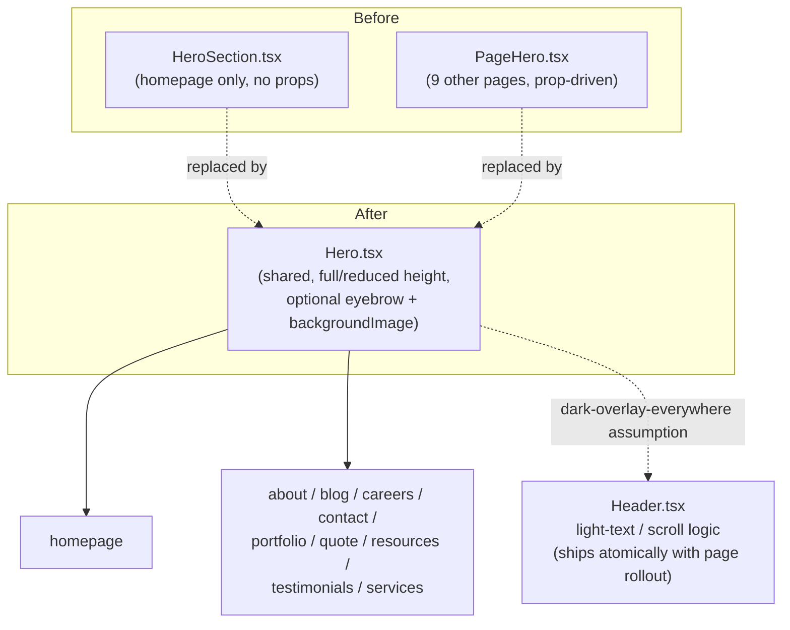

# feat: Marketing site corporate redesign

## Summary

Redesign mmc-next's public marketing site (all ~10 pages) from its current minimal, boutique visual language toward a bolder, corporate, cutting-edge aesthetic, centered on unifying the site's two divergent hero components into one new shared Hero, applying it everywhere with large-format real project photography, and carrying the sharper/bolder visual language through every page's body content — while keeping the existing brick-red brand color, page structure, and the unrelated employee portal untouched.

## Problem Frame

See origin for full motivation (see origin: docs/brainstorms/2026-10-16-marketing-site-corporate-redesign-requirements.md). In short: the current site's film-grain overlay, generous corner rounding, and organic dividers read as minimal/boutique, and Nathan wants it to read as a modern, large-corporation brand instead. Repo research surfaced two structural wrinkles the origin brainstorm didn't know about:

1. The homepage and every other marketing page currently use two completely different hero implementations (`src/components/sections/HeroSection.tsx`, bespoke to the homepage, vs. `src/components/layout/PageHero.tsx`, shared by the other nine), so a single "shared visual language" (R1) can't be achieved by touching either in isolation — this plan's central decision is unifying them.
2. The two shared files a naive "sharpen the corners" pass would reach for — `src/app/globals.css`'s `--radius-*` scale and `src/components/ui/button.tsx`'s CVA base — are both used by the employee portal too (confirmed: 8+ portal pages use the `rounded-xl/2xl/3xl/4xl` scale, and `Button` is imported across the portal). The portal's own navigation redesign is an explicitly separate, deferred brainstorm, so this plan must not touch those shared files for the radius change — see Key Technical Decisions.

## Key Technical Decisions

- **Unify `HeroSection.tsx` and `PageHero.tsx` into one new `Hero.tsx` component.** The two existing hero implementations are structurally different (a bespoke three-image collage with no props vs. a prop-driven single-image banner). Aligning them separately would leave two parallel implementations to keep in sync forever; replacing both with one shared component is the only way to guarantee R1's "one shared visual language" goal. Trade-off named explicitly: the homepage's current multi-photo collage is more visually distinctive than any single interior page's hero, and unifying trades that distinctiveness for cross-site consistency — treated as the right call for a "corporate, cutting-edge" identity, where uniformity itself is part of the signal.
- **Hero treatment is dark-overlay full-bleed photography everywhere, not the light-panel alternative the origin left open.** One consistent system is simpler to build and review than a per-page light/dark choice, makes the WCAG AA contrast requirement (R8) easy to guarantee uniformly, and matches the pattern nine of ten pages already use today via `PageHero`. Trade-off named explicitly: this forgoes roofpro's light-panel approach — the reference site closest to Nathan's own industry — in favor of consistency and build simplicity across all three very different references.
- **Sharper corners are applied via marketing-file-local Tailwind classes, not by changing the shared `--radius-*` tokens or `Button`'s CVA base.** Those two files are shared with the employee portal (see Problem Frame). Every marketing card/panel that currently hardcodes `rounded-xl`/`rounded-2xl`/`rounded-3xl` and every marketing `Button` instance gets its corner explicitly set to `rounded-lg` via a local class (Tailwind's `cn()` — `clsx` + `tailwind-merge` — correctly overrides `Button`'s base `rounded-full` when a conflicting `rounded-*` class is passed in `className`). This is the concrete radius value the origin left open: `rounded-lg`, which maps to the existing unmodified base `--radius: 0.75rem` token — no new token is introduced. The portal's cards and buttons are completely unaffected.
- **`src/app/globals.css`'s film-grain overlay and `.divider-organic` are removed globally, not scoped to marketing.** Unlike the radius scale, confirmed zero usage in the portal (`.divider-organic` only appears in `ServiceGrid.tsx`, `ServiceArea.tsx`, `Footer.tsx` — all marketing-only), so removing them has no portal-visible effect. Accepted as a global removal rather than engineering a marketing-only CSS scope for a change with no portal impact either way.
- **The paired filled+outline CTA pattern (R7) is a usage convention over existing Button variants, not a new component.** Repo research found `default` + `outline`/`outline-white`/`outline-brand` pairs already implemented in three places (`HeroSection`, `CTABanner`, the services template) — this plan extends that pattern consistently rather than duplicating it. Because the Hero is always dark-overlay, any CTA rendered inside Hero's `ctas` slot must use `outline-white`, never plain `outline` (which is designed for light backgrounds and would be low/no-contrast against a photo).
- **Hero's `backgroundImage` is optional, with the same always-dark `bg-foreground` fallback `PageHero` uses today** — not a required prop. `blog/[slug]`'s image comes from unvalidated MDX frontmatter (typed as `string` but not schema-enforced), so a required prop would let a future post with no `image:` field crash the page at render instead of degrading gracefully the way the current component does.
- **Hero gains an optional `eyebrow` prop carrying the homepage's existing "Est. 2000 · Rochester Hills" line.** R13 requires page copy to stay unchanged; without an explicit slot for it, this content would silently disappear when the homepage migrates to the unified Hero.
- **"Services page" (R1) means the existing `services/[slug]/page.tsx` detail template, applied uniformly across every slug.** There is no single services index page in this codebase today, and inventing one would be an information-architecture change R13 explicitly rules out.
- **Typography gets larger and bolder via increased font sizes using the already-loaded 700 weight, not a new typeface or weight.** `Source_Serif_4` already loads 400/600/700; adding a heavier weight would be a font-loading change outside this redesign's presentation-layer scope and isn't necessary to read as "noticeably larger, bolder."
- **`.card-hover`'s lift-on-hover interaction is not removed.** The origin's Problem Frame prose names it alongside film grain, rounded corners, and dividers as "boutique," but R5's actual requirement list never includes it. Removing it would silently expand scope beyond what R5 actually asks for.
- **Reduced-motion coverage is added via Framer Motion's native `useReducedMotion()` hook, scoped only to the components this redesign touches** (the new Hero, `AnimateOnScroll`/`StaggerContainer`, Header's mobile menu) — not a full-codebase audit. Repo research found the existing `prefers-reduced-motion` handling in `globals.css` only covers CSS `animation`/`transition`, not Framer Motion's JS-driven animations. R10 only requires not regressing current behavior, but since these specific components are being touched anyway, closing this gap here is close to free; auditing components this redesign doesn't otherwise touch is out of scope.
- **U3 (page rollout) and U4 (Header logic) ship as one atomic unit of work — same commit/PR, never deployed independently.** U4's simplified header logic assumes every page already has a dark-overlay hero; if it ships before U3 finishes converting every page, pages still on the old hero would get invisible white-on-light header text. See U3/U4 and Risks & Dependencies.
- **U7's verification checklist is a hard gate: U1-U6 are not merged/deployed until U7 passes.** With no CI enforcement in this repo, this is a process rule stated explicitly here rather than left implicit.

## High-Level Technical Design



## Requirements

**Visual direction** (see origin: docs/brainstorms/2026-10-16-marketing-site-corporate-redesign-requirements.md)

- R1. The homepage and every other marketing page adopt a new, shared visual language that reads as corporate and cutting-edge rather than the current minimal/boutique aesthetic.
- R2. The existing brick-red brand color (`--brand` / `--accent` tokens in `src/app/globals.css`) remains the primary accent color across the redesigned site.
- R3. Hero and other key imagery sections use large-format photography rather than the current small, boxed/card-style imagery, drawn from the existing project photo library. Lead-generation pages (quote, contact) use a reduced-height hero so the form stays prominent.
- R4. Headline typography shifts to a noticeably larger, bolder, more confident scale than the current treatment.
- R5. The current film-grain texture overlay, the generous corner-rounding scale, and the organic divider styling are removed or substantially reduced in favor of sharper, higher-contrast treatment.

**Structural patterns**

- R6. The header/nav stays minimal — a thin bar with few primary links.
- R7. Primary calls-to-action use a paired filled + outline button pattern.

**Accessibility & responsiveness**

- R8. Headline and CTA text placed over photography meets at least WCAG AA contrast (4.5:1 normal text, 3:1 large text).
- R9. The redesign works across mobile, tablet, and desktop, including nav-collapse, hero image cropping, and typography scaling.
- R10. Any change to the existing motion/animation treatment preserves the current `prefers-reduced-motion` support.

**Rollout & assets**

- R11. All marketing pages are redesigned and shipped together in a single rollout.
- R12. No new photography is commissioned or purchased — the existing project photo library is the asset base.
- R13. Page copy/content and the site's information architecture are unchanged — only the visual presentation layer changes.

A hero trust-signal badge was considered in the origin brainstorm and dropped before planning — no real, non-fabricated rating data source exists yet. See origin's Scope Boundaries and this plan's Scope Boundaries below.

## Implementation Units

### U1. Global film-grain and divider cleanup

**Goal:** Remove the two boutique signature details that have zero portal usage and are safe to remove globally.

**Requirements:** R5

**Dependencies:** none

**Files:**
- Modify: `src/app/globals.css`

**Approach:** Remove the `body::before` film-grain rule and its reduced-motion companion block. Remove `.divider-organic` (confirmed used only in `src/components/sections/ServiceGrid.tsx`, `ServiceArea.tsx`, and `src/components/layout/Footer.tsx` — all marketing-only, zero portal usage). Do **not** touch `--radius`, `--radius-xl`, `--radius-2xl`, `--radius-3xl`, or `--radius-4xl` in this unit — those tokens are shared with the portal (8+ pages use the `rounded-xl/2xl/3xl/4xl` utility classes they back) and are explicitly out of scope; the sharper-corner work happens per-file in U2 and U5 instead (see Key Technical Decisions).

**Test scenarios:**
- Happy path: Build locally and visually confirm no film-grain texture renders on any marketing page.
- Regression: Confirm the employee portal (`/portal/*`) is visually unaffected — same corner radii, same `--radius-*` values as before this unit.
- Edge case: `.divider-organic`'s three call sites (`ServiceGrid.tsx`, `ServiceArea.tsx`, `Footer.tsx`) no longer reference the removed class (or are updated to a replacement treatment in U5, whichever lands first).

**Verification:** `npm run build` succeeds with no new TypeScript/lint errors; a manual pass through marketing pages shows no film grain; a manual pass through at least 2 portal pages confirms zero visual change.

---

### U2. New shared Hero component

**Goal:** Build one Hero component replacing both `HeroSection.tsx` and `PageHero.tsx`: full-bleed dark-overlay photography, bold typography, WCAG AA-safe contrast with a fallback for photos that can't reach it via overlay tuning alone, height variants, reduced-motion-aware entrance animation.

**Requirements:** R1, R3, R4, R7, R8, R9, R10, R13

**Dependencies:** none (does not depend on U1 — Hero's own corner treatment and overlay are self-contained, not derived from the shared token scale)

**Files:**
- Create: `src/components/layout/Hero.tsx`
- Test file: none (no automated test suite exists in this repo yet; verified via the Playwright-style manual pass in U7)

**Approach:** Props: `title`, `subtitle?`, `eyebrow?` (carries the homepage's "Est. 2000 · Rochester Hills" line per Key Technical Decisions), `backgroundImage?` (optional — falls back to a solid `bg-foreground` section background, matching `PageHero`'s current graceful-degrade behavior, rather than requiring a value), `breadcrumbs?` (carried over from `PageHero`), `height?: "full" | "reduced"` (default `"full"`; `"reduced"` for quote/contact per R3 — omits breadcrumbs and the `ctas` pair for those two pages, since a CTA pointing back to the page's own form is redundant and the point of the reduced variant is to save vertical space), `ctas?: { label, href, variant }[]` for the paired-CTA slot — any `variant` passed here that resolves against a dark background must be `outline-white`, never plain `outline`; document this as a hard constraint on the prop, not just a convention. Full-bleed `<Image fill priority>` background with a dark gradient overlay tuned for WCAG AA against white headline, subtitle, and breadcrumb text alike (not headline-only) — tune the actual opacity/gradient values against a contrast check rather than copying `PageHero`'s existing 30%-opacity values verbatim, since those were set for a lower-impact banner use case. Add a dedicated semi-opaque scrim directly behind the text block, independent of the full-bleed gradient, as a fallback for any assigned photo where gradient tuning alone can't reach WCAG AA without making the photo unrecognizably dark. Since photos are referenced by string path (not static imports), Next.js can't auto-derive a blur placeholder — use a solid background color (matching the overlay's darkest tone) behind the `<Image>` as the loading-state placeholder instead of leaving it blank. New headline scale larger than the current `text-9xl` ceiling, within the existing `font-display` 700-weight face; replace any hardcoded `rounded-xl`/`rounded-2xl`/`rounded-3xl` panel styling from the old components with `rounded-lg` (see Key Technical Decisions — do not reintroduce the removed token scale here). Entrance animation gated behind Framer Motion's `useReducedMotion()`. `reduced` height variant uses a shorter viewport-height fraction so quote/contact's form stays above the fold.

**Technical design** (directional, not implementation-ready):
```
Hero({ title, subtitle?, eyebrow?, backgroundImage?, breadcrumbs?, height = "full", ctas? })
  -> <section>: solid bg-foreground base, full-bleed Image (fill, priority) if backgroundImage present + gradient overlay + text-area scrim
  -> motion wrapper: animate only if !useReducedMotion()
  -> breadcrumbs (optional, top; omitted when height === "reduced")
  -> eyebrow (optional) -> title (new large scale) -> subtitle
  -> ctas.map(Button variant=...) (omitted when height === "reduced")
```

**Patterns to follow:** `src/components/layout/PageHero.tsx` for the `<Image fill>` + gradient-overlay technique and its optional-`backgroundImage` fallback (reuse the technique, not the literal opacity values or the removed radius classes). `src/components/ui/button.tsx` variants for the CTA slot — pass `className="rounded-lg"` to override the shared `rounded-full` base per Key Technical Decisions.

**Test scenarios:**
- Happy path: Render with `height="full"`, a sample photo, and an `eyebrow`; full-bleed background, legible headline, eyebrow line present, both CTA buttons render as a filled + `outline-white` pair with sharp (`rounded-lg`) corners.
- Happy path: Render with `height="reduced"`; shorter viewport height than `full`, and no breadcrumbs or CTA pair rendered.
- Edge case: No `backgroundImage` passed; component renders the solid `bg-foreground` fallback with no broken image request and text stays legible.
- Edge case: No `subtitle`, `eyebrow`, or `breadcrumbs` passed; component renders cleanly with no empty gaps.
- Accessibility: Measure the actual text-over-overlay contrast ratio for headline, subtitle, and breadcrumb text sizes; confirm each meets WCAG AA (4.5:1 / 3:1). Confirm the fallback scrim activates and restores AA contrast when tested against the lightest-toned photo in the assigned library.
- Accessibility: With `prefers-reduced-motion: reduce` simulated, the entrance animation doesn't play (instant render), while the photo/overlay/text still render correctly.
- Responsive: At mobile viewport width, the background photo crops without losing its subject, and the headline scales down without overflowing or wrapping awkwardly.

**Verification:** Hero renders correctly in isolation on at least one real page (confirmed in U3) across both height variants, passes the contrast check (including the fallback-scrim path), and respects reduced-motion.

---

### U3. Apply new Hero across all marketing pages, with photo mapping

**Goal:** Replace every page's current hero with the new shared Hero, assign each page a usable project photo, and delete the two now-unused components.

**Requirements:** R1, R3, R9, R11, R12, R13

**Dependencies:** U2

**Files:**
- Modify: `src/app/(marketing)/page.tsx`, `about/page.tsx`, `blog/page.tsx`, `blog/[slug]/page.tsx`, `careers/page.tsx`, `contact/page.tsx`, `portfolio/page.tsx`, `quote/page.tsx`, `resources/page.tsx`, `testimonials/page.tsx`, `services/[slug]/page.tsx`
- Modify: `src/content/blog/how-much-does-landscaping-cost-oakland-county.mdx` (frontmatter `image` field)
- Delete: `src/components/sections/HeroSection.tsx`, `src/components/layout/PageHero.tsx`

**Approach:** Each page swaps its current hero usage for `<Hero ... />`, selecting a photo from the 13 usable files in `public/images/site/` (excluding `blue-stone.jpg`, `fire-pit.jpg`, `outdoor-kitchen.jpg` — see origin Dependencies/Assumptions) that best matches its content; some repetition across pages is an accepted tradeoff per the origin doc. Homepage passes the `eyebrow` prop with the existing "Est. 2000 · Rochester Hills" copy. `quote` and `contact` use `height="reduced"`. `blog/[slug]` and `services/[slug]` keep sourcing their background image dynamically (post image / service `heroImage`) rather than a fixed assignment — confirm those dynamic images meet the same resolution/aspect-ratio bar as the 13 "usable" library photos, or fall back to Hero's no-image `bg-foreground` treatment if a specific post/service image is undersized. **Known collision to fix as part of this unit:** `how-much-does-landscaping-cost-oakland-county.mdx`'s frontmatter currently points `image` at `outdoor-kitchen.jpg` (640x480), one of the three excluded low-resolution files, and that same field doubles as the post's thumbnail on `blog/page.tsx`'s listing grid — update the frontmatter to one of the 13 approved photos so both the hero and the listing thumbnail use a usable image. Delete `HeroSection.tsx` and `PageHero.tsx` once no page references them.

**Patterns to follow:** U2's Hero component API.

**Test scenarios:**
- Happy path: Each of the 10 pages renders its hero via the new shared component with no console errors.
- Covers AE1: The homepage hero specifically shows a full-bleed project photo with bold headline text and the eyebrow line, and the old 3-photo collage plus film grain are gone.
- Edge case: `quote` and `contact` render with the `reduced` height variant, forms visibly above the fold on a typical desktop viewport, no breadcrumbs or redundant CTA pair shown.
- Edge case: `blog/[slug]` and `services/[slug]` render correctly for at least two different dynamic image inputs (a real blog post image, a real service `heroImage`), confirming the dynamic-image path doesn't break the Hero component.
- Regression: The `how-much-does-landscaping-cost-oakland-county` post's hero and its listing-page thumbnail both use the updated, non-excluded image.
- Regression: No remaining imports of `HeroSection` or `PageHero` exist anywhere in the codebase after deletion (confirm via search before removing the files).

**Verification:** `npm run build` succeeds; manual pass through all 10 pages (plus 2 dynamic blog/service examples) confirms each renders the new Hero correctly with an appropriate photo and height variant.

---

### U4. Header alignment with the unified hero system

**Goal:** Update Header's light-text/scroll logic to match the fact that every marketing page now has the same dark-overlay hero at the top, rather than the previous route-keyed assumption that only interior pages did.

**Requirements:** R1, R6

**Dependencies:** U2, U3 — **ships atomically with U3** (same commit/PR; never merged or deployed independently). U4's logic assumes every page already renders a dark-overlay hero. If U4 lands before U3 finishes converting every page, any page still on the old hero gets invisible white-on-light header text. See Key Technical Decisions and Risks & Dependencies.

**Files:**
- Modify: `src/components/layout/Header.tsx`

**Approach:** Since every marketing page's hero is now dark-overlay (homepage included, once U3 lands), Header's `hasDarkHero`/`lightText` logic no longer needs a homepage-vs-interior branch — simplify to apply light text whenever unscrolled, on every marketing page. Keep the existing scroll-triggered utility-bar collapse and mobile full-screen-overlay menu pattern (R6: already minimal) unchanged.

**Patterns to follow:** Existing `useScrollPosition()` hook and `AnimatePresence` mobile-menu pattern in `Header.tsx` — keep, just simplify the light-text condition.

**Test scenarios:**
- Happy path: On the homepage, header text renders light/white while unscrolled (previously dark here, since homepage wasn't treated as a "dark hero" route).
- Happy path: On an interior page, header behavior is unchanged from today.
- Regression: The mobile hamburger menu and scroll-collapsing utility bar still function identically to before.

**Verification:** Manually scroll through the homepage and at least one interior page, confirming header text color transitions correctly at the scroll threshold on both, verified only after U3 has landed in the same branch.

---

### U5. Section-level visual refresh (cards, headings, CTA pairing, Header buttons)

**Goal:** Carry the sharper, bolder visual language through every page's body content and the persistent Header CTAs — section headings, cards, CTA button pairing — so the whole site reads as part of one redesigned system, not just the heroes.

**Requirements:** R1, R2, R4, R5, R7

**Dependencies:** none (marketing-file-local changes, independent of U1's globals.css edits)

**Files:**
- Modify: `src/components/sections/StatsBar.tsx`, `ServiceGrid.tsx`, `WhyChooseUs.tsx`, `CTABanner.tsx`, `TestimonialPreview.tsx`, `ServiceArea.tsx`
- Modify: `src/components/layout/Header.tsx` (its two hardcoded `rounded-full` Button overrides — desktop nav CTA and mobile menu CTA)
- Modify: `src/app/(marketing)/about/page.tsx`, `blog/page.tsx`, `blog/[slug]/page.tsx`, `careers/page.tsx`, `contact/page.tsx`, `portfolio/page.tsx`, `quote/page.tsx`, `resources/page.tsx`, `testimonials/page.tsx`, `services/[slug]/page.tsx` (their custom inline sections — team cards, benefit cards, review cards, FAQ, forms, dark CTA panels, etc.)

**Approach:** Every hardcoded `rounded-xl`/`rounded-2xl`/`rounded-3xl` class in these files becomes `rounded-lg` (see Key Technical Decisions — this is the mechanism that actually sharpens corners sitewide on marketing, since U1 deliberately does not touch the shared token scale). Every `Button` instance in these files that currently relies on the default pill shape gets `className="rounded-lg"` added (tailwind-merge resolves the conflict with `Button`'s base `rounded-full` correctly) — this explicitly includes Header's two hardcoded-`rounded-full` CTAs, which would otherwise silently keep the old pill shape since nothing else in this plan touches them. Bump section-heading sizes (`.font-display` usages) to match the larger scale established in U2. Ensure every CTA-button-pair instance across these sections uses `default` + the appropriate outline variant, matching the background it sits on — light background → `outline`/`outline-brand`; dark band → `outline-white` (e.g. `CTABanner`'s default dark variant, which already does this correctly today — extend the same rule elsewhere, rather than the services why-us section, which has no buttons in it).

**Patterns to follow:** `CTABanner.tsx`'s existing paired-Button-variant usage on its dark background (already correct per repo research — extend it, don't reinvent it).

**Test scenarios:**
- Happy path: Spot-check each modified section component in a real page context — sharper corners, larger headings, no layout regressions in grids/cards.
- Covers AE2: Previously-rounded cards in these components (and the pages listed above) are now `rounded-lg`, visibly sharper than before.
- Happy path: Header's desktop nav CTA and mobile menu CTA both render at `rounded-lg`, not the previous pill shape.
- Edge case: Dark-background sections use `outline-white` for their outline CTA, not `outline`, to stay legible.
- Regression: The employee portal's own `Button` instances are unaffected — this unit only adds `className` overrides within marketing files, never changes `button.tsx` itself.

**Verification:** Manual visual pass through all 10 pages' body content and the persistent Header confirms consistent heading scale, corner treatment, and correct CTA variant choice against each section's background.

---

### U6. Reduced-motion coverage for touched motion components

**Goal:** Close the gap where Framer Motion's JS-driven animations don't currently respect `prefers-reduced-motion`, scoped to the components this redesign touches.

**Requirements:** R10

**Dependencies:** U2, U4

**Files:**
- Modify: `src/components/layout/Hero.tsx` (confirm handled, if not already done in U2), `src/components/ui/AnimateOnScroll.tsx`, `src/components/ui/StaggerContainer.tsx` (or wherever `StaggerContainer`/`StaggerItem` are defined), `src/components/layout/Header.tsx` (mobile menu `AnimatePresence`)

**Approach:** Use Framer Motion's `useReducedMotion()` hook at each touched animated component to skip the animation (render final state immediately) when the user prefers reduced motion, consistent with the existing CSS-only reduced-motion behavior for non-Framer-Motion elements. Do not extend this to motion components outside this redesign's touch surface (e.g. `CTABanner`'s own entrance animation, unless U5 otherwise modifies it) — that's a separate, broader accessibility audit out of scope here (see Scope Boundaries).

**Patterns to follow:** `src/components/ui/BackToTop.tsx`'s existing `window.matchMedia('(prefers-reduced-motion: reduce)')` check — same intent, but use Framer Motion's `useReducedMotion()` hook for components already using `motion.*`.

**Test scenarios:**
- Happy path: With `prefers-reduced-motion: reduce` simulated, Hero, `AnimateOnScroll`-wrapped sections, `StaggerContainer`-wrapped sections, and Header's mobile menu all render final-state immediately with no animated transition.
- Regression: With reduced-motion off (default), all touched components still animate as before.

**Verification:** Manual check with the OS/dev-tools "prefers reduced motion" setting toggled on, confirming no JS-driven animation plays on the touched components while content still renders correctly.

---

### U7. Cross-page accessibility and responsive verification pass — ships only when this passes

**Goal:** Verify the redesign meets its accessibility, responsive, and brand-consistency requirements across all 10 pages. Per Key Technical Decisions, this unit's checklist is a hard gate: U1-U6 are not merged or deployed until every item below passes.

**Requirements:** R2, R8, R9, R11 (R10 is verified by U6 directly, not re-tested here)

**Dependencies:** U1, U3, U4, U5, U6

**Files:** none (verification-only unit)

**Approach:** A Playwright-based or manual pass (matching this repo's established verification pattern — no committed automated test suite exists yet) across all 10 pages at representative mobile/tablet/desktop viewport widths, checking contrast, nav-collapse behavior, hero image crop-safety at narrow viewports, brand color, and that every page has actually migrated to the new system.

**Test scenarios:**
Test expectation: none — this unit is itself the verification pass for R2/R8/R9/R11/AE1-AE3; its test scenarios are the Verification criteria below.

**Verification:**
- Every one of the 10 pages shows the new Hero, sharper (`rounded-lg`) corners, and no film grain, at desktop width.
- Covers AE3: Primary CTAs and key accents across all 10 pages still render in the unchanged brand-red (`--brand`/`--accent`) value — spot-check at least 3 pages plus the Header.
- At mobile (~375px) and tablet (~768px) widths, nav collapses correctly, hero images crop without losing their subject, and headline text doesn't overflow or wrap awkwardly.
- Headline/subtitle/breadcrumb/CTA text contrast against each page's assigned hero photo meets WCAG AA (4.5:1 normal / 3:1 large text) — specifically spot-check the photos with the least headline-area contrast margin (e.g. lighter-toned ones), confirming the U2 fallback scrim activates correctly where needed.
- The employee portal is spot-checked (at least 2 pages) and confirmed visually unchanged.
- `npm run build` and `npx tsc --noEmit` pass clean with zero errors introduced by this redesign.

## Scope Boundaries

**Deferred for later**

- The portal/app navigation redesign ("SIEM-style" top tabs, fewer sections) — a separate brainstorm. This plan takes explicit care (U1, U5) not to touch the portal's shared visual tokens as a side effect.
- A professional photography refresh, if the existing library proves insufficient once real page layouts are built against it.
- The hero trust-signal badge (real rating + review count): dropped before planning — no real, non-fabricated rating data source exists yet (`src/data/testimonials.ts` is local, fabricated 5-star content). Revisit once real rating data is available.

**Outside this redesign's identity**

- Changing the brand color palette.
- Rewriting page copy, messaging, or the site's information architecture.

**Deferred to Follow-Up Work**

- A full `prefers-reduced-motion` audit of Framer Motion components this redesign doesn't otherwise touch (e.g. `CTABanner`'s own entrance animation, `StatsBar`'s counters) — surfaced by repo research but intentionally not pulled into U6.

## Risks & Dependencies

- **Photo supply is thin.** Only 13 usable photos exist for ~12 distinct hero contexts (10 pages, two of which — blog posts, service detail — need per-item images). Expect repetition, and some assigned photos may not be crop-safe for full-bleed treatment until checked in U3/U7. One known collision (a blog post using an excluded low-resolution photo) is fixed as part of U3.
- **Contrast risk on lighter photos.** The new large-headline-over-photo treatment could fail WCAG AA if the overlay gradient isn't tuned carefully for lighter-toned photos specifically. U2's text-area scrim is the named fallback mechanism for this; U7 verifies it activates correctly.
- **U3/U4 sequencing risk.** Shipping Header's simplified light-text logic (U4) before every page has the dark-overlay hero (U3) produces invisible header text on any page still mid-migration. Mitigated by the Key Technical Decision that U3 and U4 ship as one atomic unit, not independently.
- **No CI gate enforcing U7.** With no automated test suite or branch protection tying U7's pass to deployment, the "U7 is a hard gate" rule in Key Technical Decisions is a process discipline, not a technical control — whoever executes this plan is responsible for actually honoring it.
- **No existing automated test suite.** Verification across all seven units relies on manual/Playwright spot-checks, consistent with how previous features in this repo (the Active Jobs Kanban board, the portal sidebar reorg) were verified.

## Acceptance Examples

(Carried forward from origin — see origin: docs/brainstorms/2026-10-16-marketing-site-corporate-redesign-requirements.md)

- AE1. Given the homepage hero uses a large-format project photo with bold headline text (R3, R4), when compared against the current hero, then the film-grain overlay (R5) and the current boxed/card-style hero imagery (R3) are no longer present.
- AE2. Given an interior content page that previously used heavily rounded cards, when the redesign is applied (R5), then those elements use noticeably sharper corners.
- AE3. Given the existing brand red accent value, when the redesign ships (R2), then primary CTAs and key accents still use that red.

## Sources / Research

- Origin brainstorm: `docs/brainstorms/2026-10-16-marketing-site-corporate-redesign-requirements.md`.
- `src/components/sections/HeroSection.tsx` — homepage's current bespoke, no-props, 3-image-collage hero (the "boxed/card-style imagery" R3 wants replaced), including its "Est. 2000 · Rochester Hills" eyebrow line carried forward via U2's new `eyebrow` prop.
- `src/components/layout/PageHero.tsx` — the current prop-driven banner hero used by all nine other pages; already a full-bleed `<Image fill>` + dark-gradient-overlay pattern with a graceful optional-`backgroundImage` fallback, but tuned for a lower-impact banner (30% opacity) rather than a true large-format hero.
- `src/components/ui/button.tsx` — existing CVA variants (`default`, `outline`, `outline-white`, `outline-brand`) already support the paired-CTA pattern (R7) in three places (`HeroSection`, `CTABanner`, the services template); base radius is hardcoded `rounded-full` on the shared CVA string — confirmed this file is imported across 8+ employee-portal pages, which is why this plan overrides radius per-instance via `className` rather than editing this file.
- `src/components/layout/Header.tsx` — `hasDarkHero = pathname !== '/'` light-text logic, route-keyed rather than hero-content-keyed (fixed in U4); also has two hardcoded `rounded-full` Button overrides (fixed in U5).
- `src/app/globals.css` — confirmed the `--radius`/`-xl`/`-2xl`/`-3xl`/`-4xl` scale is consumed by 8+ portal pages and shared UI primitives (`badge.tsx`, `card.tsx`, `dialog.tsx`), which is why U1 does not touch it; `body::before` film-grain and `.divider-organic` confirmed to have zero portal usage, safe to remove globally; existing CSS-only `prefers-reduced-motion` block confirmed not to cover Framer Motion's JS-driven animations.
- `src/data/testimonials.ts` — local, fabricated 5-star review data; confirmed not a valid source for the (dropped) hero trust badge.
- `src/content/blog/how-much-does-landscaping-cost-oakland-county.mdx` — confirmed its frontmatter `image` field already points at `outdoor-kitchen.jpg`, one of the three photos excluded from full-bleed use; fixed in U3.
- `AGENTS.md` (repo root) — flags that this repo's Next.js 16 differs from training-data assumptions; `PageHero.tsx`'s existing `<Image fill>` usage is treated as the authoritative local pattern for the new Hero component rather than re-deriving from external docs.
- No applicable entries in `docs/solutions/` — searched; the three existing entries (Prisma-enum-derived constants, the `?tab=` merge pattern, the `.env.local` precedence gotcha) are all unrelated to this work.
